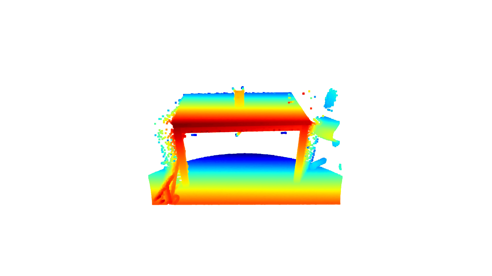
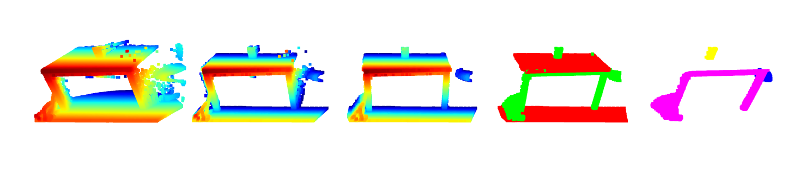

# Caldera3D 🌋

**A 3D point cloud processing pipeline in C++ that finds objects on a table, measures them and computes a grasp pose for a robot arm.** Built from scratch as the perception layer of my autonomous bin-picking project (the kinematics layer is [SIckKinematiX](https://github.com/tomekstolarczyk/SIckKinematiX)).

  

## What it does

Input: a raw point cloud of a tabletop scene (`.ply`).
Output: the object that matches a requested size (for example "the 20 × 15 cm package") and a 6-DoF grasp pose for a parallel-jaw gripper.

## Pipeline

1. **Parsing:** loads `.ply` point clouds into an internal point structure.
2. **Pass-through filter:** crops the cloud to the robot's workspace.
3. **Voxel-grid downsampling:** reduces point density while keeping the scene's shape.
4. **k-d tree (custom):** spatial index with K-nearest-neighbour and radius search, used by the steps below.
5. **Statistical outlier removal:** removes isolated noise points based on the mean distance to their neighbours.
6. **Multi-plane RANSAC:** repeatedly removes large planes (floor, walls, table) and keeps the equation of the table surface.
7. **Euclidean clustering:** splits the remaining points into separate objects.
8. **Above-table filter:** keeps only clusters whose centroid lies above the table plane.
9. **PCA oriented bounding boxes:** measures each object's length, width and height in mm and matches them against a size request from a (simulated) PLC.
10. **Grasp pose estimation:** approach direction along the bounding-box axis most aligned with the table normal, jaws closing across the shorter horizontal side, right-handed gripper frame. Outputs the TCP position, orientation and required gripper opening.

Python scripts using Open3D visualise the output of each stage.

  

## License

MIT. See the [LICENSE](LICENSE) file for details.
